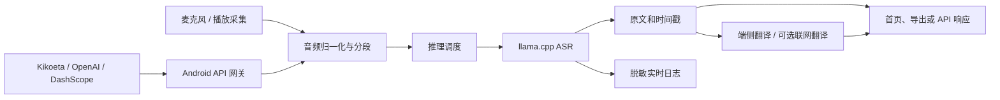

# Qwen 听写 Android 重构交接

2026-11-18 · 起点为 Android 0.1.1 · 本文供实现、设计和真机验收使用。

## 1. 产品目标

Qwen 听写是一款端侧听写、翻译、字幕应用，也能为其他应用提供语音识别服务。首次配置后，冷启动直接进入「实时翻译」。用户能够在应用内下载模型、检测设备、开始采集和查看日志。离线翻译是首版默认路径，联网翻译是手动开启的选项。Kikoeta 保留现有接入，同时新增 OpenAI Audio 与阿里云百炼 DashScope 原生协议。

已确认两款 ASR 模型为 **Qwen3-ASR-0.6B Q8_0** 和 **Qwen3-ASR-1.7B Q8_0**。轻量版使用 Qwen 官方的 0.6B 名称，某些 Hugging Face 页面或转换统计会显示约 0.9B。UI 只显示一款轻量版。用户所说的 Dashboard 是百炼 **DashScope** API。

## 2. 现有工程与真机基线

| 位置 | 已有功能与接手注意事项 |
| --- | --- |
| `MainActivity.java` | Java 原生单页，设置、导入、字幕混排。前端重构的主要替换入口。 |
| `DictationService.java` | Android 前台服务管理推理、麦克风、播放音频捕获和悬浮字幕。0.1.1 先绑定 API，再异步预热模型。 |
| `Inference.java` | 启动打包的 llama-server，固定 HTP0、CPU 音频编码和 2048 上下文。也有手填外部引擎地址和 OpenAI 兼容文本翻译。现有工作路径可用于回归。 |
| `LiveCapture.java`、`Pcm.java` | 16 kHz PCM、3 秒实时分段和 8 秒批量分段、静音过滤、转写与翻译分队列、SRT/LRC。保留可复用采集与导出逻辑。 |
| `Jobs.java`、`Wire.java` | Kikoeta 的 Basic Auth、任务状态、事件游标、缓存、结果下载。薄 HTTP 实现未覆盖通用 multipart、流式协议或 LAN 入口。 |
| `Stage-Hexagon.ps1`、`app/build.gradle` | 从外部路径暂存 llama.cpp 原生制品。当前资源位于忽略的 `app/runtime/`。 |

- 已验证设备是 SM8850、Hexagon v81、Android API 37，llama.cpp 为 build 12470、commit `dde9de82c`。普通 APK 进程可驱动 HTP。1.7B Q8_0 主模型的 29/29 层卸载到 HTP0，音频编码器走 CPU，播放内录、SRT 和 Kikoeta LRC API 在真机通过。GPU、HTP 音频编码、0.6B 和离线翻译仍需基准测试。
- 保留包名 `dev.workspace.qwen.asr`、签名升级路径、Kikoeta 地址 `127.0.0.1:2370`、Basic 账号及随机密码、已导入 GGUF、已完成缓存和私有 LRC 路径。现有 `files/model.gguf` / `files/mmproj.gguf` 通过元数据或摘要识别后原地登记，迁移失败时仍可使用文件导入。签名不能复用时需先确定数据导出和迁移方式。
- HyperOS 曾在前台服务运行时冻结其 UID。应用级电池优化豁免后，Kikoeta 在前台连续 60 秒访问缓存成功。首次指南中仅在诊断到相关问题时提供系统应用设置入口，并保留独立的 API 监听状态与模型状态。

## 3. 新 Android 界面和交互

建议用 Kotlin、Jetpack Compose 与 Material 3 实现新页面，通过 `ViewModel` / `StateFlow` 订阅服务状态。现有 Android Service、AudioRecord、MediaProjection、导出和协议代码可逐步迁移，服务与关键状态独立于 Activity 生命周期。Compose 依赖需在实现阶段固定到当前 AGP/SDK 可用版本。

底部导航按「实时翻译 / 服务 / 日志 / 设置」布局。紧凑屏和横屏均可操作。首页采用高对比度的字幕画布，主色建议深靛青配单一青绿色强调，提供跟随系统的亮暗色方案。译文主字号 22–26sp，原文 14–16sp，使用支持中日文的系统字体。状态仅用可读短标签，确认触控区至少 48dp、200% 字号可用、TalkBack 可读，并在新字幕到达时保持输入按钮位置稳定。

| 页面 | 屏幕内容与行为 |
| --- | --- |
| 实时翻译（默认首页） | 顶部显示语种、模型与实际后端状态。主区域显示待机、加载、监听、原文、译文及掉段。底部固定音源、开始/结束。支持麦克风、获授权的播放音频、原文/译文/双语显示、跟随最新句、选中文本、悬浮字幕和 SRT 导出。用户向上翻阅时停止自动滚动。译文按片段 ID 更新对应原文。首次打开模型未就绪时只引导配置。 |
| 服务 | 独立开关与状态，显示绑定 IP、端口、三种协议的实例 URL、认证信息、模型预热状态、请求数、队列和错误。凭据默认遮挡，显式复制。提供连通测试和可复制的最小示例。 |
| 日志 | 显示 llama.cpp 和应用运行时的结构化实时日志，区分级别、组件和会话。支持搜索、过滤、暂停跟随、查看最新、复制、清空和脱敏导出。 |
| 设置 | 分组入口为模型、推理、翻译、音频、服务和诊断。高级推理参数放在子页，变更前标出即时生效或需重新加载。模型页显示已安装、下载速度、剩余空间、校验状态和卸载入口。 |

首轮设计验收需交付首页的未配置、下载中、识别中、已出双语、设备不支持播放捕获、离线包缺失六种状态，以及服务页和推理设置页的真机截图。首页展示真实功能文案及错误。

## 4. 首次安装

1. 检查 ABI、系统版本、剩余存储及本次安装可用的运行时组件。首页允许稍后配置。首次打开无需录音或悬浮权限。
2. 短时探测 CPU、GPU、NPU，显示“可用 / 探测失败 / 当前构建未提供 / 不支持”。检测超时后仍可选择 CPU。显示推荐的运行组合与原因。
3. 选择轻量或高质量模型。默认推荐轻量档，展示主模型与匹配 mmproj 的总大小。支持 Wi-Fi 下载、显式允许移动网络、进度、取消、断点续传、磁盘不足提示，以及使用 SAF 导入 GGUF。配套文件通过校验后一起生效。
4. 选择源语种或自动检测、目标语种。建议默认目标为简体中文。下载并验证离线翻译包，缺包时可先进入首页听写。允许在模型页后续补齐。
5. 短样本本机自检，展示实际音频编码与语言模型后端。随后进入实时翻译首页。第一次点麦克风、播放捕获、悬浮字幕时再发起对应的系统权限流程。服务监听默认仅本机。

引导进度可恢复。升级安装识别已配置状态，直接进入首页。首次模型下载需要联网，资产齐备后的听写和离线翻译须可在飞行模式完成。

## 5. 运行时自动配置与推理设置

### 设备和模型

- 交付内置运行时和固定版本构建脚本。CI 从经审核的 llama.cpp commit 与固定 Android 工具链构建 arm64 制品，记录 ABI、编译选项、库文件及 SHA-256。随 APK 打包或随签名版本交付，应用安装后自行加载。Windows 测试路径与 ADB 暂存只用于开发构建，用户只通过模型页和设置页操作。
- CPU 为基础路径。GPU 通过实际打包的 OpenCL 或 Vulkan 后端枚举及试跑，NPU 首批为 Qualcomm Hexagon HTP。芯片名和 Android 能力信息仅作提示，后端必须在普通 App UID 下成功初始化。测试 CPU、GPU、NPU 的可用性需分别记录。运行请求记录实际卸载层数和主要计算设备，也报告混合执行。
- 设备探针包含运行时枚举和一条短音频的试跑，缓存键包含固件指纹、ABI、运行时版本、设备与模型。升级、崩溃或驱动异常后允许重测。自动档仅选择已经验证的组合。人工档失败时展示确切组件与原因，提供一键切回自动或 CPU。禁止静默把失败的分配报告为 NPU 或 GPU。
- 模型清单固定上游 revision、两个 GGUF 的精确 URL、长度、SHA-256、格式、许可和匹配关系。使用临时文件、断点续传、校验和原子替换。禁止把模型放进 Git。现有 1.7B 真机资产可用于对照。

| 模型卡 | 主文件 | 配套文件 | 发布前验收 |
| --- | --- | --- | --- |
| 轻量 · Qwen3-ASR-0.6B Q8_0 | `Qwen3-ASR-0.6B-Q8_0.gguf`，约 805 MB | `mmproj-Qwen3-ASR-0.6B-Q8_0.gguf`，约 214 MB | 核实完整下载清单，CPU 与支持的加速组合均通过短样本。 |
| 高质量 · Qwen3-ASR-1.7B Q8_0 | `Qwen3-ASR-1.7B-Q8_0.gguf`，约 2.17 GB | `mmproj-Qwen3-ASR-1.7B-Q8_0.gguf`，约 356 MB | 在 SM8850 复现 HTP 层卸载、重启和旧资源迁移。 |

大小为十进制展示值，两款模型加上配套文件的下载量分别约为 1.02 GB 和 2.53 GB。UI 的精确大小来自发行清单。 [轻量版文件](https://huggingface.co/ggml-org/Qwen3-ASR-0.6B-GGUF/tree/main) · [高质量版文件](https://huggingface.co/ggml-org/Qwen3-ASR-1.7B-GGUF/tree/main)

### 用户可选组件

| 设置 | 默认和选项 | 实施约束 |
| --- | --- | --- |
| 音频文件解码 | 自动、Android 系统硬件/软件解码、PCM/WAV 直读 | 按 MIME、设备与 codec 枚举后显示，统一混音、重采样到模型所需 PCM。麦克风和系统播放采集本身走 PCM。 |
| ASR 音频编码器 / mmproj | 自动、CPU、已验证 GPU、已验证 NPU | CPU 路径已在真机验证。`--no-mmproj-offload` 能选择 CPU。加速路径要验证具体算子和 projector 调度，独立指定设备若现有二进制不支持，需以绑定设备的 JNI/libmtmd 或受控小补丁实现。 |
| ASR 文本生成 / 语言模型解码器 | 自动、CPU、已验证 GPU、已验证 NPU | 通过运行时枚举设备、配置层卸载并核对实际 log/buffer。用户可以组合音频编码和文本生成设备。 |
| 优先级与预设 | 自动平衡、低延迟、高质量、省电 | 使用经基准测试的预设组合。手动详情可覆盖字段，设有恢复默认。 |
| 高级推理 | CPU 线程、批尺寸、上下文、最大输出、卸载层数、单实例并发和空闲释放 | 为每个运行时版本记录参数支持及边界。换模型或后端应用于新会话，处理中的任务可完成或经用户确认后取消。 |
| 分段与字幕 | 源语言提示、VAD、最短/最长分段、静音阈值、端点等待、实时队列上限 | 先保持已验证的约 3 秒窗口，再用 VAD 对照漏字、重字、首句时延及积压。时间戳基于样本计数，导出使用最终片段。 |

首版必须验证 CPU→CPU 与 CPU 音频编码→HTP 文本生成。CPU→GPU、GPU→GPU、GPU→HTP、HTP→HTP 等组合按实测开放。CPU 音频编码＋HTP 文本生成是 SM8850 上的已知可用配置。保留一个常驻推理实例，内部监听独立 loopback 和随机令牌。所有外部接口通过应用网关，前台服务状态与 HTTP 预热状态独立。 [llama.cpp Snapdragon 后端](https://github.com/ggml-org/llama.cpp/blob/master/docs/backend/snapdragon/README.md)

### 翻译与运行日志

- 定义 `Translator` 接口，接收转写文本、源语言、目标语言和片段 ID。默认离线，完成相邻语段的有限上下文处理，译文迟到也能回填对应时间段。开始时显示离线包状态。缺包或翻译失败时保留原文和 SRT 能力。联网翻译只有在用户配置并选中后才发送转写文本。
- 第一轮工程验证以 ML Kit 端侧语言包为候选，评估日语→简中、英语→简中及 SM8850 目标固件的下载可用性。日中质量需用对照样本验证，ML Kit 的非英语语言对经英语中转。若国行设备无法稳定下载，发布前换成可从应用镜像交付、许可合规的独立离线翻译包。离线方案选型以断网真机和日中质量验收决定。 [ML Kit 端侧翻译概述](https://developers.google.com/ml-kit/language/translation/) · [Android 模型管理](https://developers.google.com/ml-kit/language/translation/android)
- Runtime 日志事件包含时间、级别、组件、run ID、模型和可脱敏消息。默认捕捉启动、设备分配、加载失败、prompt/decode 时间和重启，采用有限环形缓冲。日志页可看实际设备、卸载层、RTF、排队和掉段计数。凭据、音频数据、转写内容和含签名的 URL 在进入缓冲前清除。分享日志由用户触发。

## 6. API 网关与网络策略

统一内核使用 `AudioInput → InferenceScheduler → Transcript(segments, language) → Translator?`。协议适配只负责校验、鉴权、生命周期和序列化。每个适配器独立开关，限连接数、音频大小、任务时长和队列深度，断开即停止无用同步任务。直播采集优先，批量任务在片段边界让出并保留进度。文件与流各用有界缓冲。

| 协议 | 首版接口与兼容边界 |
| --- | --- |
| Kikoeta | 保持 `/api/v1/health`、`/api/v1/jobs`（创建/读取/事件/取消/暂停/恢复）、`/api/v1/cache` 与结果下载。默认原有本机端口和 Basic Auth。保留结果索引、事件游标、缓存格式及目标 LRC。继续允许模型加载期间查询缓存。 |
| OpenAI Audio | `GET /v1/models` 与 `POST /v1/audio/transcriptions`，Bearer，multipart 的 `file`、`model`、可选 `language`。先支持 `json` 和 `text`，对能力外的参数和格式返回明确的 OpenAI 风格错误。两款模型有稳定 ID，收到未安装的模型请求返回提示。实现 `verbose_json`、SRT/VTT、翻译或 SSE 前分别定义时间戳、目标语言和流式事件契约。回归用原生 OpenAI SDK 访问可配置 base URL。 |
| 百炼 DashScope 同步 ASR | `POST /api/v1/services/aigc/multimodal-generation/generation`，Bearer 本地 Key。接受文档的 `input.messages` 音频内容和受支持的 `parameters.asr_options`，返回 `output.choices[].message.content`、`request_id`、用量字段和原生错误格式。先支持 Base64/受策略约束的 HTTP(S) 音频 URL。用真实 DashScope SDK 替换 endpoint 测试。云模型别名需显式映射到本地模型，默认配置展示实际 ASR 模型。 |
| 百炼实时与异步扩展 | 实时任务以选定的百炼 WebSocket 事件族为验收契约，优先对照 Paraformer 任务式 `run-task → task-started → PCM → result-generated → finish-task → task-finished`，另测 `task-failed` 和连接复用。若目标客户端使用 Qwen3-ASR-Flash-Realtime 会话协议，独立实现并测试。长音频异步可复用任务队列，采用百炼 `POST /api/v1/services/audio/asr/transcription` 与 `GET /api/v1/tasks/{task_id}` 的提交和轮询语义。首版按目标客户端确定必需的扩展，界面按已通过的协议能力展示。 |

在线文档和测试 fixture 固定到实现时采用的 API 契约。将 HTTP 路径、鉴权、缺字段、重试、队列满、取消和错误体纳入契约测试。Kikoeta 自带 URL 和请求头，跨源跳转只转发允许的头。通用 URL 取音默认限制经过验证的协议、来源和目标网络，逐次检查重定向和最终连接地址。设备内网来源由用户单独授权，限制本机服务、链路本地地址、额外凭据和绝对文件路径访问。

[OpenAI Audio API](https://platform.openai.com/docs/api-reference/audio/createTranscription) · [DashScope Qwen-ASR REST](https://help.aliyun.com/zh/model-studio/qwen-asr-api-reference) · [DashScope Paraformer WebSocket](https://help.aliyun.com/zh/model-studio/websocket-for-paraformer-real-time-service) · [Kikoeta Transl](https://github.com/chenflxs/kikoeta-transl)

| 端口模式 | 绑定和访问判定 |
| --- | --- |
| 仅本机（默认） | API 绑定 `127.0.0.1` 和可用的 `::1`。保留对相应适配器的认证。 |
| IP 白名单 | 按用户选择的绑定接口启动 listener，支持 IPv4/IPv6 主机与 CIDR。根据 TCP 对端地址判断，统一 IPv4 映射地址。空列表仅允许本机，默认忽略代理伪造的来源头。IP 检查适用于 HTTP 和 WebSocket。 |
| 全开 | 对选定接口允许任意来源 IP；每个协议继续要求 API Key 或 Basic。展示实际绑定地址和网络范围，启用需用户主动选择。支持 TLS 或受控的外部 TLS 终止，管理界面未授权时保持本机。应用不配置公网端口映射。 |

变更端口和模式要验证数字范围、占用、双栈绑定与证书配置。绑定失败保持原监听，界面显示原因。转为更严格模式时，立即拒绝或终止已经失去权限的连接。密钥放在本机安全存储，接口健康页在鉴权后展示详细信息。限流和请求体限制独立于 IP 策略。

## 7. 实施顺序与验收门槛

| 阶段 | 交付 | 完成条件 |
| --- | --- | --- |
| A · 固化基线 | 原型源码、可复现构建、设备探针、两份模型清单 | 固定工具链和上游 commit，干净环境构建，核对已验证的 SM8850/CPU 路径；现有 Kikoeta 通过回归。 |
| B · 新首页与首次引导 | Compose 导航、模型管理、硬件推荐、实时翻译和日志页 | 全新安装可走完引导至首页。权限拒绝、网络中断、下载续传、校验失败和低存储都可恢复。旧 APK 升级能读模型和缓存。 |
| C · 端侧翻译与推理设置 | 离线语言包、音频与文本设备组合、自检、日志导出 | 飞行模式中对短日语和英语生成简中双语 SRT。量化测试两个模型，记录首段延迟、译文补齐延迟、RTF、峰值内存、掉段、异常回退及 10 分钟稳定性。阈值基于设备基准设定。 |
| D · 服务网关 | 本机/白名单/全开、OpenAI 和 DashScope、Kikoeta 兼容 | Android 和局域网客户端各跑真实 SDK。IPv4/IPv6、合法和非法 IP、令牌失效、并发、上传限制和端口切换有实测。再次验证 HyperOS 切回 Kikoeta 后缓存请求持续成功。 |

需要保留的自动化结果包括模型清单验证、设置迁移、API golden 响应、时间戳/任务状态测试和一份真机验证记录。建议真机至少覆盖当前 SM8850 和一台无 Hexagon 的 arm64 Android，GPU 档有实际设备证据才开放。

待在 A 阶段定案的是 DashScope 的目标 SDK/客户端样本（决定实时及异步扩展进入首版的顺序）、最终离线翻译包和可公开发布的许可证及签名策略。模型文件可再分发、界面语言包和各地区证书信任条件分别查证。以上重构功能在 0.1.1 基线中尚未实现。

## 资料索引

- Qwen 官方模型名称、语种和 ASR 能力。 [QwenLM/Qwen3-ASR](https://github.com/QwenLM/Qwen3-ASR)
- 两个 GGUF 转换仓库和配套音频 projector。 [0.6B](https://huggingface.co/ggml-org/Qwen3-ASR-0.6B-GGUF/tree/main) · [1.7B](https://huggingface.co/ggml-org/Qwen3-ASR-1.7B-GGUF/tree/main)
- Android 播放捕获和前台服务。 [Audio playback capture](https://developer.android.com/media/platform/av-capture) · [Foreground service types](https://developer.android.com/develop/background-work/services/fgs/service-types)
